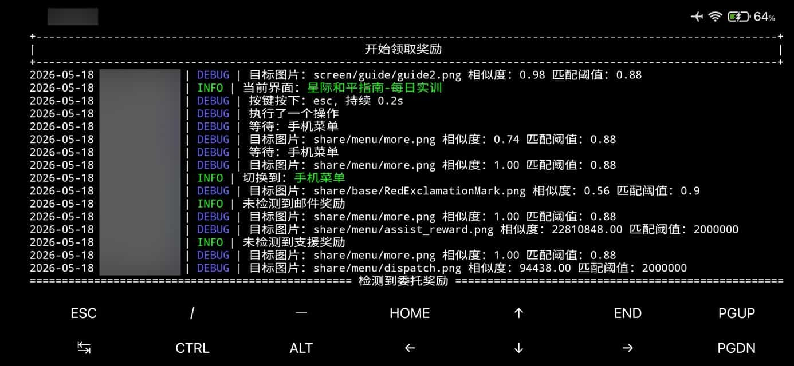

# 阅读器排版样例 · Reader sample

> 本文件由简体中文版转换。此段演示译文声明。

运行前请读[使用教程](/assets/docs/Tutorial.md)。选择「设置 → 运行方式 → 本地操作模式」，也可以先去「任务 → 清体力 → 刷什么 → 副本类型」。历史路径「设置 → 旧版入口」保留原文。

## 提示框与行内格式

> 这是一段普通说明，含 **粗体与 *斜体***、`inline code`、~~删除线~~ 和 [**带强调的链接**](https://m7a.top/)。

正文分行使用两个空格。  
第二行也可以用 <kbd>Ctrl</kbd> + <kbd>K</kbd>，或显式换行<br>接着读。

> [!TIP]
> **想一边用电脑一边运行？** 可阅读 [Windows 后台模式](Background.md#windows-后台模式)。

---

> 注意：游戏切换期间请稍候。

---

> [!CAUTION]
> **恢复前请检查备份！** 这里演示危险提示的标题和正文。

---

> [!IMPORTANT]
> 保留你的原始记录。

### 混合列表

3. 第一项从三开始
4. 第二项
    - 子项一，含 *English* 与中文
    - 子项二

## 平台对照

| 平台 | 本地 | 云端 | 备注 |
| :--- | :---: | ---: | --- |
| Windows | ✅ | ✅ | 支持 |
| Android | ❌ | ⚠️ | 部分可用 |
| 很长的标识 | 已移除 | 文字和 ✅ | ThisIsOneVeryLongUnbrokenEnglishWordForCheckingNarrowParagraphWrappingAndHorizontalOverflow |

## 代码与复制

```bash
# Example
if true; then echo "ready 1"; fi
```

```powershell
# Display a message
if (2) { Write-Output '就绪' }
```

```cmd
REM Example
echo "ready" 2
```

```yaml
enabled: true
count: 3
label: "中文"
```

```text
设置 → 运行方式 → 本地操作模式
```

```example
<unknown> "123" # 原样复制
```

## 图片与跳转




行内图片  后面还有文字。外部地址 [https://example.org/documentation/long-unbroken-address-for-manual-layout-inspection?language=zh_CN](https://example.org/documentation/long-unbroken-address-for-manual-layout-inspection?language=zh_CN)。

[查看常见问题](#/assets/docs/FAQ) · [本页](#平台对照) · [不存在的目标](missing.md) · [打开设置](setting:local_control_mode)

<details open><summary>补充说明</summary><p>包括 <mark>未知行内标签里的字</mark>。</p></details>

## 平台对照

重复标题检查尾缀定位。
